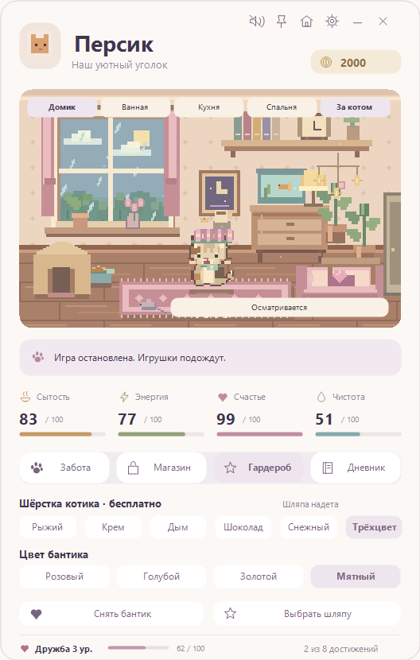
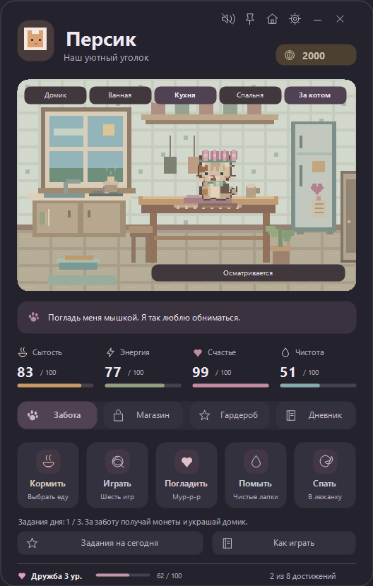

# Персик — уютный пиксельный питомец для Windows

Небольшое приложение с котиком-тамагочи: четыре комнаты, самостоятельные прогулки, уход, мини-игры и гардероб. Работает без интернета, регистрации, рекламы и покупок за реальные деньги.

**[Скачать готовое приложение для Windows](https://github.com/x-peria15-svg/persik-desktop/releases/latest)** · [Инструкция](docs/QUICKSTART.txt) · [История изменений](CHANGELOG.md)



## Запуск

1. Откройте [последний релиз](https://github.com/x-peria15-svg/persik-desktop/releases/latest).
2. Скачайте `Persik-3.0.0-Windows.zip` из раздела **Assets**.
3. Распакуйте архив и запустите `Persik/PixelCat.exe`.

Нужна Windows 10/11 с **.NET Framework 4.8**, который обычно уже установлен. Права администратора не требуются. Приложение переносимое, не добавляет себя в автозагрузку. Исполняемый файл не подписан сертификатом; Windows может предупредить о неизвестном издателе. Рядом с архивом опубликован `SHA256SUMS.txt` для проверки скачивания.

Кнопки **Source code** скачивают исходники; готовое приложение находится именно в архиве `Persik-…-Windows.zip`.

## Что умеет котик

- Гуляет по домику, кухне, ванной и спальне, проходит через двери, прыгает на мебель, отдыхает и играет с вещами. Кнопка **За котом** включает следящую камеру.
- Ест, спит, моется под душем и радуется поглаживанию мышью. Сытость, энергия, счастье и чистота меняются со временем. Мурчание можно отключить.
- Играет в **шесть мини-игр**: светлячки, клубочек, рыбалка, память, охота на мышку и ловля рыбы на точность.
- Зарабатывает монеты за заботу и задания. В магазине **18 предметов**: 12 интерактивных украшений и 6 головных уборов.
- Примеряет берет, колпак волшебника, корону, вязаную шапку, венок и соломенную шляпу. Одновременно носит одну шляпу; покупки остаются в коллекции.
- Меняет шесть расцветок шёрстки и четыре цвета бантика в **Гардеробе**. Перекрашивание бесплатное; бантик покупается за игровые монеты.
- Сохраняет достижения, дружбу, покупки, имя, оформление и состояние. Есть светлая и тёмная тема, компактный режим и системный трей.



На предмет можно нажать прямо в комнате или выбрать **Использовать** в магазине. Правая кнопка по этой кнопке убирает украшение; вернуть его можно бесплатно. Для шляп есть кнопки **Надеть / Снять**. Самостоятельные прогулки отключаются в настройках. Бантик и шляпу можно носить вместе.

## Сохранение и приватность

Состояние хранится только на вашем компьютере: `%LOCALAPPDATA%\PixelCat\pet.json`. Приложение не отправляет телеметрию, не использует сеть и не читает личные файлы. Сохранение совместимо с предыдущими версиями Персика. Повреждённый JSON сохраняется в резервную копию перед новым стартом.

Время вне приложения учитывается до восьми часов за один перерыв. Незаконченные мини-игры и душ не продолжаются после перезапуска. Положение котика внутри комнаты начинается с центра; выбранная комната сохраняется.

## Сборка из исходников

В PowerShell в корне клонированного репозитория:

```powershell
./build.ps1
```

Готовый файл: `build/PixelCat.exe`. Для сборки используется компилятор .NET Framework из Windows. NuGet-пакеты, Python, Node.js и Visual Studio не требуются.

Проверки и упаковка:

```powershell
./build.ps1 -Test
./pack.ps1
```

Для снимков интерфейса во время проверок:

```powershell
./build.ps1 -Test -Screenshots ./build/screenshots
```

Тесты используют отдельное временное сохранение. Код тестов компилируется в `build/Persik.Tests.exe` и не входит в пользовательское приложение. Автоматические проверки покрывают сохранения, миграцию, потребности, покупки, шляпы, раскраску, награды, игры, перемещение между комнатами, прыжки и душ. Звук не проверяется автоматически на слух.

## Устройство проекта

| Файл | Назначение |
|---|---|
| `src/Model.cs` | Состояние, сохранения и каталог магазина |
| `src/App.cs`, `src/Widgets.cs` | Интерфейс и действия |
| `src/HomeLife.cs`, `src/HomeUI.cs` | Самостоятельное поведение и камера |
| `src/Art.cs` | Пиксельная графика комнат и котика |
| `src/Activities.cs` | Дополнительные мини-игры |
| `src/Wardrobe.cs` | Гардероб, расцветки и рисование шляп |
| `tests/` | Отдельная проверочная программа |

При сворачивании частота обновления снижается; графические кисти и портрет котика переиспользуются. Графика и звуковая волна создаются программой — сторонние изображения и аудиозаписи не включены.

## Участие и лицензия

[Как предложить изменение](CONTRIBUTING.md) · [Сообщить об уязвимости](SECURITY.md)

Код и включённая графика распространяются под **Apache-2.0**: [LICENSE](LICENSE), [NOTICE](NOTICE). Это самостоятельный проект; он не связан с другими приложениями о виртуальных питомцах. Код собирается из открытых исходников, релизы содержат те же функциональные возможности без скрытых установщиков.

---

**English:** Persik is an offline Windows pixel-cat tamagotchi with four rooms, six mini-games, autonomous behavior, an interactive shop, hats, coat colors and light/dark themes. Download the Windows ZIP from **Releases**. Build on Windows using `./build.ps1`; run tests with `./build.ps1 -Test`. Requires .NET Framework 4.8. Licensed under Apache-2.0.
